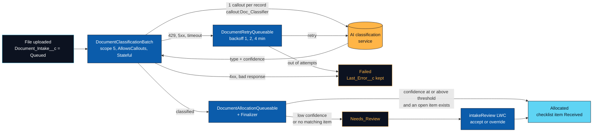

# apex-async-document-pipeline

An async Salesforce pipeline that sends uploaded documents to an AI classification service and files each one against the right checklist item, with retries, a review queue and nothing dropped on the floor.


## Why this exists

Teams that collect documents (applications, onboarding packets, claims) spend a lot of time opening files just to see what they are and ticking the matching box on a checklist. A classification model can do most of that, but calling it from Salesforce means living inside callout limits, handling a service that is sometimes slow or down, and deciding what happens when the model is unsure. This repo is a working answer to those three problems, small enough to read in one sitting.

## How it works



`Document_Intake__c.Status__c` tells you where every file is:

| Status | Meaning |
| --- | --- |
| Uploading | Intake record exists, file not attached yet |
| Queued | Waiting for the batch, or waiting for its next retry |
| Classifying | Classified, allocation pending |
| Allocated | Linked to a checklist item, item marked Received |
| Needs_Review | Low confidence, no matching item, or file too large. `Review_Reason__c` says which |
| Failed | Not retryable, or out of attempts. `Last_Error__c` says why |

## Design decisions

### Batch scope is 5, and the code says why

Each record makes one callout with a 20 second timeout. Per `execute()` transaction the platform allows 100 callouts and 120 seconds of total callout time.

| Limit | At scope 5 | Binding? |
| --- | --- | --- |
| 100 callouts | 5 x 1 = 5 | No |
| 120 s callout time | worst case 5 x 20 s = 100 s | **Yes** |
| 12 MB async heap | 5 files at up to 1 MB + one base64 copy + one JSON body, about 8 MB | Close second |

So `scope = floor(120 / (callouts per record x timeout)) - 1 = floor(120 / 20) - 1 = 5`. At 6 the worst case is exactly 120 s, so one slow file could fail the whole chunk. `SCOPE_SIZE` is computed from `CALLOUTS_PER_RECORD` and `TIMEOUT_MS` rather than typed in, and a test asserts the math. Adding a second callout per record (an OCR step, say) drops it to 2 without anyone hunting for a magic number. Files over 1 MB skip the callout and go to review, and their bodies are never loaded into the heap: file metadata is queried first, bodies second, only for files under the cap.

### Stateful counters, kept small

`Database.Stateful` keeps the per-run counts (processed, classified, sent to review, failed, save errors) and the set of Ids that need a retry across chunks. Stateful members are serialized between chunks, so they hold integers and Ids only, never sObjects or file bodies. `finish()` logs one summary line and starts a single retry job for the whole run instead of one per chunk.

### Callouts first, DML second, allocation in its own transaction

Apex refuses a callout once the transaction has uncommitted work, so the processor makes every callout for the chunk, then writes all results in one partial-success update. Allocation is handed to a Queueable so a validation rule or row lock on a checklist item cannot roll back classification results we already paid a callout for. That Queueable attaches a Transaction Finalizer first: if the job dies with an unhandled error, the finalizer moves its documents to Needs_Review with the error instead of leaving them in Classifying.

### Retry with capped exponential backoff, scheduled on the record

Timeouts, HTTP 429 and 5xx are retryable. HTTP 4xx and malformed responses are not, because sending the same thing again gives the same answer. Every failure lands in `Last_Error__c` with the attempt number, a timestamp and the exception type.

A retryable failure sets `Next_Attempt_At__c` to `now + base x 2^(attempt - 1)` minutes, capped at 10 (the most `System.enqueueJob` will delay). With the defaults (base 1, 4 attempts) a document is tried at roughly t0, t0+1, t0+3 and t0+7 minutes, then marked Failed. `DocumentRetryQueueable` wakes at the earliest due time, processes one scope's worth, and re-enqueues itself for whatever is still waiting.

Two platform rules shaped this:

- An async job may enqueue only one more job. The batch uses its slot for allocation, so retries are collected and started once from `finish()`. The retry job needs its slot for its own follow-up, so it allocates inline.
- If a retry chain ever dies, its records sit in Queued with an overdue retry time. The batch treats anything more than 30 minutes overdue as orphaned and picks it up again, so the system heals itself without a separate sweeper.

### Recursion guard is a `Set<Id>`, not a static Boolean

A large DML runs the trigger in chunks of 200 inside one transaction. A static Boolean set by the first chunk silently skips every later chunk. The guard's real job is narrower: when a flow or another trigger updates the same record again in the same transaction, `Trigger.old` still holds the pre-transaction values, so "just became Allocated" looks true twice. A `Set<Id>` skips exactly the records already handled and nothing else. There is a test for each half of that.

### Confidence threshold lives in Custom Metadata

`Pipeline_Setting__mdt.Default` holds the confidence threshold (80%), max attempts (4) and base backoff (1 minute). An admin can tune them per org and deploy them like code, and `getInstance()` reads them without using a SOQL query. Tests pin their own values in memory so they never depend on what an org has configured.

### Named Credential, no secrets in code

Apex only knows `callout:Doc_Classifier`. The host lives in the Named Credential and the API key lives in an External Credential principal you fill in after deploying. Both files ship as templates with a placeholder URL and no key. Access to the principal is granted through the `Document_Pipeline_User` permission set, so only users who should call the service can.

### User mode everywhere

All SOQL uses `WITH USER_MODE` and all DML uses `AccessLevel.USER_MODE`, so the batch, the queueables and the review screen respect the running user's object, field and sharing access. Tests run as a Standard User with the permission set, which proves the permission set is complete. The one exception is the "is a batch already running?" check, which reads `AsyncApexJob` in system mode because it exposes job status only.

### Reviewer decisions stay auditable

`Suggested_Type__c` always holds what the classifier said. The reviewer's choice goes to `Confirmed_Type__c`, so you can later measure how often reviewers override the model and on which types.

## Project structure

```text
apex-async-document-pipeline/
├── config/project-scratch-def.json
├── force-app/main/default/
│   ├── classes/
│   │   ├── DocumentClassificationBatch.cls       # scope math, Stateful counters, orphan sweep
│   │   ├── DocumentClassificationProcessor.cls   # callouts first, then one partial-success update
│   │   ├── DocumentClassifierService.cls         # HTTP callout, DTOs, typed exceptions
│   │   ├── DocumentRetryQueueable.cls            # backoff chain driven by Next_Attempt_At__c
│   │   ├── DocumentAllocationQueueable.cls       # allocation in its own transaction
│   │   ├── DocumentAllocationFinalizer.cls       # safety net if allocation dies
│   │   ├── DocumentAllocationService.cls         # threshold + checklist matching rules
│   │   ├── DocumentIntakeTriggerHandler.cls      # Set<Id> recursion guard
│   │   ├── DocumentClassificationScheduler.cls   # cron entry point
│   │   ├── IntakeReviewController.cls            # LWC backend, cacheable reads
│   │   ├── IntakeFiles.cls                       # two-step file loading under the size cap
│   │   ├── AsyncJobs.cls                         # enqueue seam that tests can capture
│   │   ├── RetryPolicy.cls  PipelineSettings.cls  DocumentTypes.cls  IntakeStatus.cls
│   │   ├── TestDataFactory.cls  ClassifierHttpMock.cls
│   │   └── *Test.cls                             # 7 test classes
│   ├── customMetadata/Pipeline_Setting.Default.md-meta.xml
│   ├── externalCredentials/Doc_Classifier_Auth.externalCredential-meta.xml
│   ├── lwc/intakeReview/                         # review queue: accept or override
│   ├── namedCredentials/Doc_Classifier.namedCredential-meta.xml
│   ├── objects/
│   │   ├── Application__c/
│   │   ├── Checklist_Item__c/
│   │   ├── Document_Intake__c/
│   │   └── Pipeline_Setting__mdt/
│   ├── permissionsets/Document_Pipeline_User.permissionset-meta.xml
│   └── triggers/DocumentIntakeTrigger.trigger
├── sfdx-project.json
└── LICENSE
```

## Deploy to a scratch org

You need the Salesforce CLI (`sf`) and a Dev Hub.

```bash
# Once per machine
sf org login web --set-default-dev-hub --alias devhub

# Create a scratch org and deploy
sf org create scratch --definition-file config/project-scratch-def.json --alias doc-pipeline --set-default --duration-days 7
sf project deploy start --source-dir force-app
sf org assign permset --name Document_Pipeline_User
sf org open
```

Then point it at your classifier:

1. Edit the URL in `namedCredentials/Doc_Classifier.namedCredential-meta.xml` (or in Setup > Named Credentials).
2. In Setup > Named Credentials > External Credentials > **Doc Classifier Auth**, edit the **DefaultGroup** principal and add an authentication parameter named `ApiKey`.
3. Schedule the batch, or run it once from Anonymous Apex:

```apex
DocumentClassificationBatch.run();
```

The service is expected to accept `POST /v1/classify` with `{ documentId, fileName, fileExtension, contentBase64, candidateTypes }` and answer `{ documentType, confidence (0 to 1), modelVersion }`.

To add the review screen, open any Lightning page in App Builder and drop in **Document Intake Review**. On an Application record page it shows that application's documents; on an app or home page it shows all of them.

## Run the tests

```bash
sf apex run test --code-coverage --result-format human --wait 20
```

| Test class | What it covers |
| --- | --- |
| `DocumentClassifierServiceTest` | HttpCalloutMock success, HTTP 500, 429, 400, timeout, network failure, malformed JSON, empty body, bad confidence, missing type, type normalization |
| `DocumentClassificationBatchTest` | Scope math, start query (first attempts, stale retries, 200 records), success, 500 and timeout retry paths, 400 and last-attempt failure, missing file, oversized file, record deleted mid-run, end-to-end run, scheduler |
| `DocumentRetryQueueableTest` | Exponential backoff, final attempt to Failed, inline allocation on success, not-yet-due records, more due than one scope, records moved on by a user, delay rounding |
| `DocumentAllocationQueueableTest` | Allocation, low confidence to review, inclusive threshold, no matching item, no application, 200-record bulk with constant query and DML counts, finalizer safety net |
| `DocumentIntakeTriggerHandlerTest` | Starting status, file arrival, manual re-queue, checklist item Received, recursion guard on re-fire, guard not blocking other records, 200-record bulk insert and update |
| `IntakeReviewControllerTest` | Listing with and without filter, percent conversion, picklist options, accept, override, partial failures, empty and oversized requests |
| `PipelineSupportTest` | Custom metadata reads and fallbacks, backoff doubling and cap, max attempts, enqueue with and without delay |

Tests never call the real service. `ClassifierHttpMock` returns whatever a test asks for, and `AsyncJobs` lets tests assert which job would be queued and with what delay, instead of relying on how the platform runs chained async work inside a test.

## Static analysis

```bash
sf code-analyzer run --target force-app --rule-selector pmd:Recommended
```

No Critical, High or Moderate findings. What remains is Low severity: documentation style (ApexDoc on every public member), `runAs` suggestions for tests that create no data, three intentional `System.debug` summary lines, and a finalizer suggestion for the retry job, whose failure case is already covered by the batch's orphan sweep.

## License

MIT. See [LICENSE](LICENSE).

---

Built by Sonu Goswami · Portfolio: https://sonugoswami.netlify.app · LinkedIn: https://www.linkedin.com/in/sonugoswami1/
